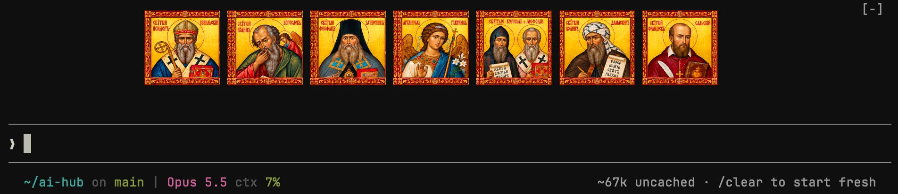
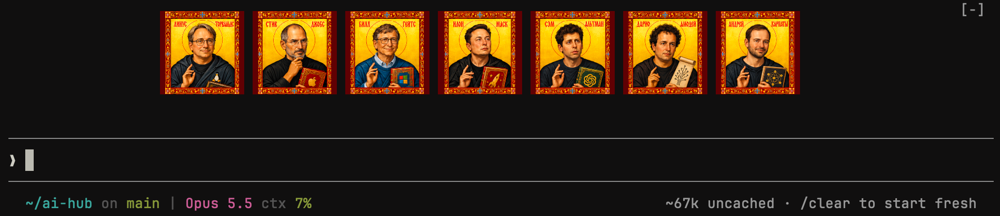

# spasi-sohrani

Мод для Claude Code: две команды показывают над строкой ввода набор из семи иконок по центру.

## Команды и режимы

| Команда | Режим | Что показывает |
|---|---|---|
| `/spasi-sohrani` | святые | семь святых, связанных со словом, знанием и связью |
| `/spasi-vibe` | vibe | семь персонажей мира технологий: Линус Торвальдс, Стив Джобс, Билл Гейтс, Илон Маск, Сэм Альтман, Дарио Амодеи, Андрей Карпаты |

Одновременно показан один набор:

- команда показывает свой набор, если иконки скрыты;
- повторный вызов той же команды скрывает иконки и отвечает «Иконки скрыты.»;
- вызов другой команды сразу заменяет показанный набор своим.

Мод запоминает показанный набор до конца сессии Claude Code.

## Когда иконки появляются сами

Даже если иконки скрыты, мод показывает их (по умолчанию набор `sohrani`) с подписью под рядом:

| Когда | Подпись | Когда исчезают |
|---|---|---|
| Claude запускает опасную команду: `rm -rf`, `git push --force`, `git reset --hard`, `git clean -f`, `git restore .`, `git branch -D`, `git stash drop`, `DROP TABLE`, `sudo`, `chmod -R`, `curl … \| sh`, `kubectl delete`, `terraform destroy` и подобные, или MCP-инструмент с `delete`/`trash`/`destroy`/`drop`/`purge`/`remove` в имени | «Lord, have mercy: <команда>» — видна уже на запросе разрешения | при следующем сообщении |
| контекст заполнен на 80% и больше (проверяется в конце каждого хода) | «My cup runneth over: context N% full, time to /compact» | после compact |
| идёт compact (ручной или автоматический) | «Blessed are the summarized…» | когда compact закончится |

Если набор показан вручную, подпись появляется под ним.

## Состав наборов

### `/spasi-sohrani`



| Иконка | Связь с интернетом и digital |
|---|---|
| **Исидор Севильский** | **Интернет, базы знаний, поиск и систематизация информации.** Его предлагали считать покровителем интернета, но официально этого не провозглашали. |
| **Иоанн Богослов** | **Авторы, редакторы, создатели содержательного контента.** Для нашей серии — символ ответственного обращения со словом; специальное покровительство digital-профессиям здесь не подразумевается. |
| **Феофан Затворник** | **Сосредоточенная работа, цифровая гигиена, дистанционное наставничество.** Символ внимания и внутренней дисциплины среди информационного шума. |
| **Архангел Гавриил** | **Связь, телекоммуникации, передача сообщений.** Официально провозглашён покровителем телекоммуникаций; связь с сетями и мессенджерами — современное продолжение этой темы. |
| **Кирилл и Мефодий** | **Программирование, языки, кодировки, локализация и перевод.** Это символическая аналогия: создание языка и передача смысла между разными системами. |
| **Иоанн Дамаскин** | **Архитектура знаний, техническая документация, визуальная коммуникация.** Символ стройного изложения сложных идей и осмысленной работы с изображениями. |
| **Франциск Сальский** | **Журналистика, копирайтинг, блоги, SMM и редактура.** Считается покровителем писателей и журналистов; распространение на digital-контент — современная интерпретация. |

### `/spasi-vibe`

Шуточные иконки: реальные люди из мира технологий и то, чему они «покровительствуют».



| Персонаж | Чему «покровительствует» |
|---|---|
| **Линус Торвальдс** | Открытому коду, системному программированию, сисадминам и порядку в репозиториях. |
| **Стив Джобс** | Продуктовому мышлению, интерфейсам, дизайну и вниманию к деталям. |
| **Билл Гейтс** | Разработчикам прикладного софта, офисной автоматизации и совместимости. |
| **Илон Маск** | Инженерным амбициям, автоматизации, смелым запускам и невозможным дедлайнам. |
| **Сэм Альтман** | ИИ-продуктам, стартапам, привлечению инвестиций и превращению исследований в массовые сервисы. |
| **Дарио Амодеи** | Надёжности ИИ, безопасности моделей, вдумчивым экспериментам и осторожной работе с мощными системами. |
| **Андрей Карпаты** | Обучению машинному обучению, понятному коду, нейросетям и объяснению сложного простыми словами. |

## Файлы иконок

Файлы каждого набора лежат в своей папке: `assets/sohrani/` (`01-isidore-of-seville` … `07-francis-de-sales`) и `assets/vibe/` (`01-linus-torvalds` … `07-andrej-karpathy`).

- `png/` — исходники по одному файлу на иконку: 321×321 у `sohrani`, 342×342 у `vibe`.
- `jpg/` — копии PNG, уменьшенные до 180×180, для приложения Claude. Векторные исходники (около 1,1 млн символов) больше лимита, который движок принимает для одного SVG (131 072 символа), а копии 320×320 приложение не показывало (около 50 тысяч символов каждая). Поэтому при размере больше 90 px на экране Retina иконки будут чуть размыты.
- Терминал показывает PNG из `png/`.

## Установка

В терминальной сессии Claude Code:

```
/plugin install spasi-sohrani --marketplace ponomr/spasi-sohrani
```

Ответьте `y` на вопрос о добавлении маркетплейса и выберите область установки.

Из командной строки:

```bash
claude plugin install spasi-sohrani --marketplace ponomr/spasi-sohrani
```

В приложении Claude (вкладка Code), где `/plugin` не работает: нажмите + рядом с полем ввода → Plugins → Add marketplace → `ponomr/spasi-sohrani` → Add plugin.

## Где видны картинки

- Приложение Claude, VS Code, мобильное приложение — иконки как изображения; если ряд не помещается по ширине, он переносится.
- Терминал — только kitty и Ghostty (протокол графики kitty). В остальных терминалах вместо картинок выводятся подписи.

## Настройка

- `Icon size (px)` — высота иконки в приложении, по умолчанию 90, от 32 до 400. В терминале иконки занимают 5 строк.
- `Auto icon set` — какой набор появляется сам: `sohrani` (по умолчанию) или `vibe`.
- `Show on dangerous commands` — показывать ли иконки на опасных командах, по умолчанию да.
- `Context threshold (%)` — с какого заполнения контекста напоминать про `/compact`, по умолчанию 80, от 50 до 100; 100 выключает напоминание.

## Разработка

```bash
claude --plugin-dir /path/to/spasi-sohrani
claude plugin validate .
claude plugin test .
```
